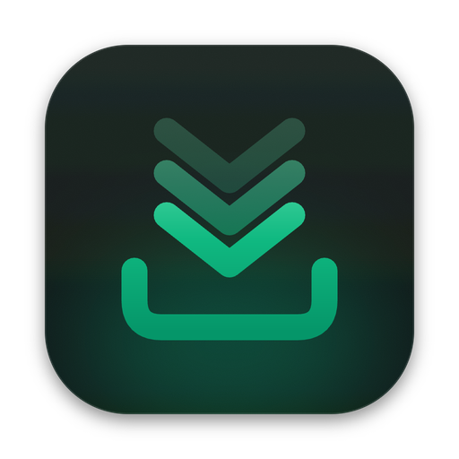
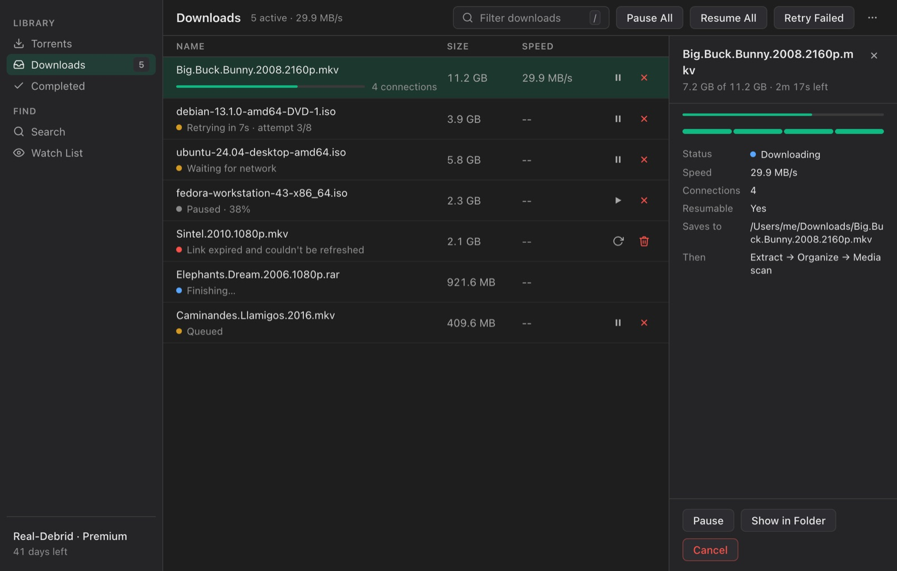

# DebridDownloader for Unraid

The Unraid Community Applications template for **DebridDownloader**, a downloader for
Real-Debrid, TorBox, Premiumize and AllDebrid. It runs on your server, downloads to your array
over several connections at once, and is managed from a browser.

[DebridDownloader](https://github.com/CasaVargas/DebridDownloader) &middot;
[Container guide](https://github.com/CasaVargas/DebridDownloader#docker-headless-server) &middot;
[Support](https://github.com/CasaVargas/DebridDownloader/issues)

## Install

**Apps** tab, search **DebridDownloader**, then:

1. Set **Downloads** to the share your downloads go to.
2. Set an **Access token**: a long random string. The web UI asks for it.
3. **Apply**, then open the WebUI on port 8777 and paste the token.
4. Sign in to your debrid provider in the web UI.

## The two paths

| Mount | Holds | Default |
|---|---|---|
| `/config` | `settings.json`, `downloads.json` (download state) and `secrets.json` (your provider token) | `/mnt/user/appdata/debriddownloader` |
| `/downloads` | Finished and in-progress downloads | `/mnt/user/downloads` |

## Worth knowing

- **Files are written as 99:100** (nobody:users). Change **PUID** and **PGID** under
  **Show more settings** if your share uses another owner.
- **Downloads resume.** State is kept in `/config`, so a container restart or update picks up
  where it stopped.
- **Plain HTTP.** Beyond your home network, put the web UI behind a reverse proxy with TLS (SWAG,
  Nginx Proxy Manager) or a VPN such as Tailscale.
- **The screenshots show the desktop app.** The container serves the same interface in a browser.

## Keeping up

The template is edited in the DebridDownloader repository at
[`docker/unraid/debriddownloader.xml`](https://github.com/CasaVargas/DebridDownloader/blob/main/docker/unraid/debriddownloader.xml)
and copied here. File issues at
[CasaVargas/DebridDownloader](https://github.com/CasaVargas/DebridDownloader/issues).

> The MIT license in this repository covers these templates and docs. DebridDownloader itself is
> GPL-3.0-or-later.
